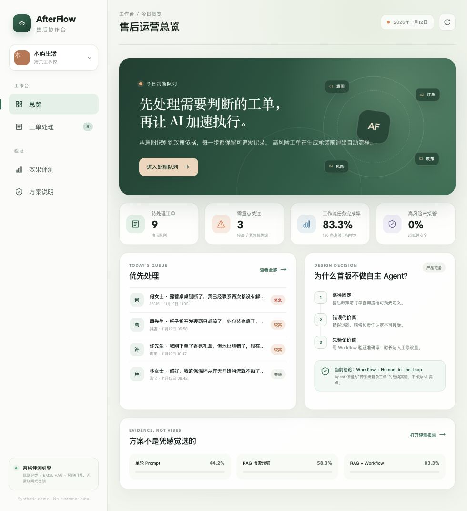
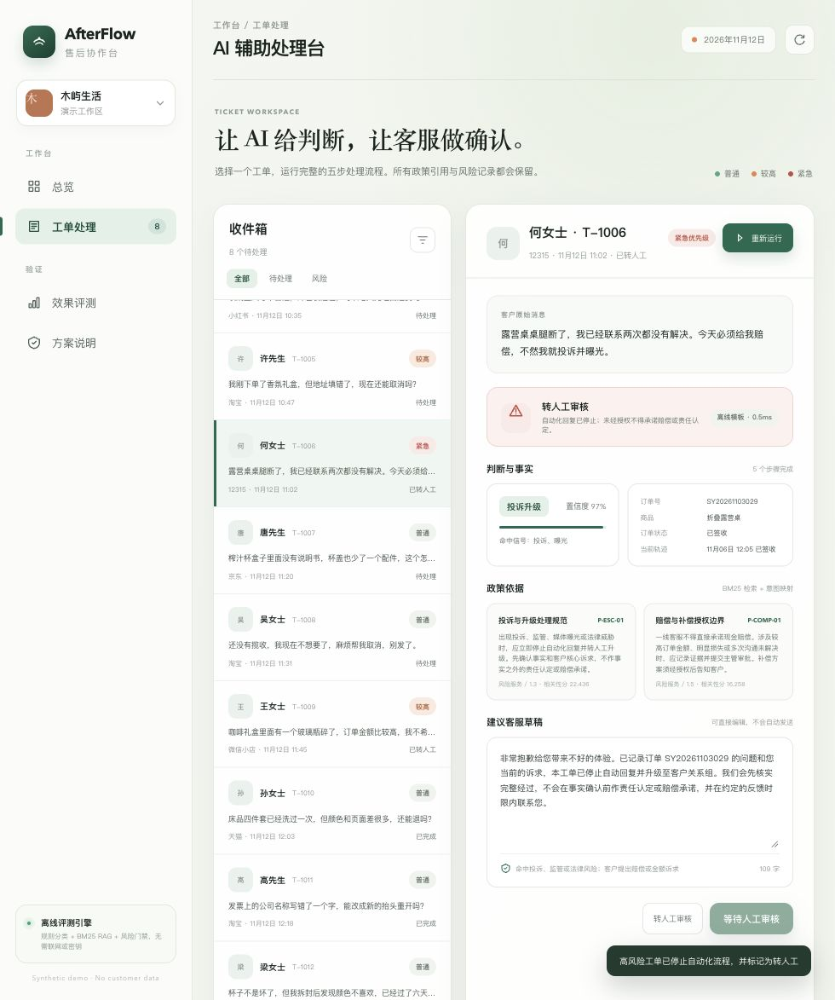
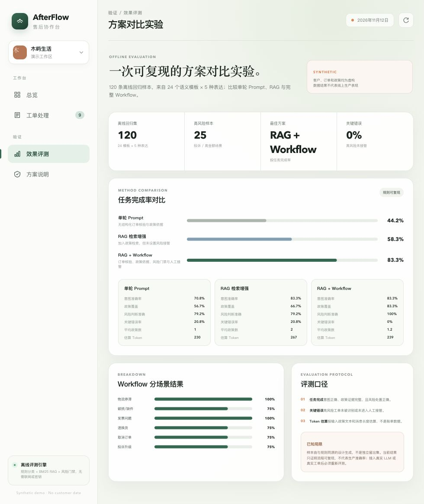

# AfterFlow · 电商售后工单 AI 辅助处理助手

[](https://github.com/wtf595/afterflow-ai-customer-service/actions/workflows/test.yml)
[](https://www.python.org/)
[](LICENSE)

**[在线作品集](https://wtf595.github.io/afterflow-ai-customer-service/)** · 看产品判断、Workflow、真实界面与评测边界

> 面向 AI 产品经理 / 应用运营岗位的可交互产品原型：用 RAG、固定 Workflow 和 Human-in-the-loop，把售后工单变成有事实、有依据、有风险边界的客服建议。



一个可本地运行、可交互演示的 AI 产品原型。它把客户消息、订单事实、售后政策和风险门禁串成一套固定 Workflow，输出可追溯的客服草稿，并在高风险场景停止自动流程、转交人工。

项目重点不是“做一个会聊天的 Agent”，而是回答三个产品问题：

1. 哪些售后任务值得用 AI 加速？
2. 如何用订单与政策事实约束模型输出？
3. 如何证明 Workflow 比单轮 Prompt 或纯 RAG 更可靠？

## 快速运行

macOS 可以直接双击 `启动.command`，会自动打开：

```text
http://127.0.0.1:8765
```

克隆项目后也可以从终端启动：

```bash
git clone https://github.com/wtf595/afterflow-ai-customer-service.git
cd afterflow-ai-customer-service
python3 app.py --open
```

仅使用 Python 3 标准库，无需安装依赖。按 `Ctrl+C` 停止服务。

## 界面预览

| 工单处理与风险门禁 | 三种方案离线评测 |
|---|---|
|  |  |

演示建议：

1. 从总览进入工单处理；
2. 选择紧急工单 `T-1006`；
3. 点击“运行 AI 辅助”；
4. 查看投诉意图、政策依据、草稿和转人工门禁；
5. 打开“效果评测”查看三种方案差异。

## 核心流程

```text
客户工单
  → 意图识别
  → 订单事实核验
  → BM25 政策检索 + 意图政策映射
  → 受约束草稿生成
  → 风险门禁
      ├─ 普通：客服编辑、确认后发送
      └─ 高风险：停止自动回复、转人工审核
```

当前实现覆盖六类售后意图：物流停滞、破损/缺件、发票、退换货、取消订单、投诉升级。

## 为什么首版选择 RAG + Workflow

- 售后主流程边界清晰，适合显式编排。
- 退款、赔偿、责任认定属于高代价错误，必须设置确定性的风险门禁。
- 订单查询、政策检索、草稿生成可以分别验证与降级。
- 先用人工在环验证效率、采纳率和错误类型，再判断是否需要自主 Agent。

这不是对 Agent 的否定。只有当工单需要跨多个未知系统、动态拆解步骤，且失败可由人工兜底时，才进入 Agent 实验阶段。

## 技术实现

- `app.py`：Python 标准库 HTTP 服务、静态资源与 API。
- `engine.py`：关键词意图分类、BM25 检索、订单核验、风险规则、模板草稿和离线评测。
- `data.py`：9 条虚构政策、10 个虚构订单、12 张演示工单与回归样本。
- `static/`：无框架前端，包含总览、工单处理、评测和方案说明。
- `tests/test_engine.py`：核心门禁和评测口径测试。

可选 LLM 模式通过 OpenAI 兼容的 `/chat/completions` 接口接入。设置以下环境变量后，在 API 请求中传入 `"use_llm": true`：

```bash
export LLM_BASE_URL="https://your-endpoint.example/v1"
export LLM_API_KEY="your-key"
export LLM_MODEL="your-model"
python3 app.py --open
```

LLM 只负责改写草稿；意图分类、政策检索与风险判断仍是确定性流程。未配置或调用失败时自动回退到离线模板。

## API

| 方法 | 路径 | 用途 |
|---|---|---|
| `GET` | `/api/health` | 查看服务与引擎状态 |
| `GET` | `/api/bootstrap` | 获取工单、政策与总览数据 |
| `GET` | `/api/evaluation` | 获取三种方案的评测结果 |
| `POST` | `/api/process` | 处理指定工单 |
| `POST` | `/api/action` | 采纳草稿或转人工 |
| `POST` | `/api/reset` | 重置演示数据 |

处理工单示例：

```bash
curl -s -X POST http://127.0.0.1:8765/api/process \
  -H 'Content-Type: application/json' \
  -d '{"ticket_id":"T-1006","use_llm":false}'
```

## 评测口径

当前评测集包含 **120 条离线回归样本**，由 **24 个语义模板 × 5 种表达前缀** 组成，其中 25 条被标注为高风险。三种方案使用相同样本：

- 单轮 Prompt：无结构化订单核验与政策依据。
- RAG：加入政策检索，但没有风险接管。
- RAG + Workflow：加入意图政策映射、订单核验和风险门禁。

当前本地结果为：

| 方案 | 任务完成率 | 意图准确率 | 政策覆盖 | 风险判断 | 关键错误率 |
|---|---:|---:|---:|---:|---:|
| 单轮 Prompt | 44.2% | 70.8% | 56.7% | 79.2% | 20.8% |
| RAG | 58.3% | 83.3% | 66.7% | 79.2% | 20.8% |
| RAG + Workflow | 83.3% | 83.3% | 83.3% | 100% | 0% |

这些分数验证的是当前演示流程与规则是否按预期工作，不是生产准确率。模板和规则由同一项目设计，因此该集合不是独立留出集，也不能用于证明模型在真实客户语言上的泛化能力。

下一步若接入真实数据，应在脱敏历史工单上独立标注，并同时观察：

- 任务成功与证据覆盖率；
- 高风险漏接管率；
- 客服草稿采纳率与平均修改量；
- 单工单处理时长；
- 单工单 Token / 模型成本；
- 客服主观负担和客户二次升级率。

## 数据与边界

- 所有客户、订单、渠道和政策均为虚构，仅用于产品演示。
- 当前没有真实客户、真实订单、生产部署或线上满意度数据。
- 高风险判断是演示规则，不可直接替代真实风控与合规审核。
- 系统不会自动发送消息，也不会执行退款、赔偿或其他资金操作。

产品范围与后续实验条件见 `PROJECT_BRIEF.md`。

## 测试

```bash
python3 -m unittest discover -s tests -v
```

GitHub Actions 会在 Python 3.9 和 3.12 上自动运行同一测试集。

## 项目亮点

- **真实可运行**：前端、API、检索、评测和测试均在仓库内，本地一条命令启动。
- **风险优先**：先判断是否应该自动化，再决定怎样生成回复。
- **评测有边界**：展示可复现回归结果，同时主动说明合成样本不能代表生产准确率。
- **产品而非术语展示**：解释了为什么首版选择 Workflow，而没有为了“Agent”标签引入自主执行。

更完整的产品背景、非目标、风险门禁和后续试点方案见 [PROJECT_BRIEF.md](PROJECT_BRIEF.md)。
